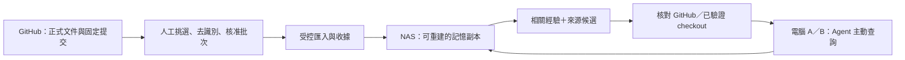

> Planning snapshot approved for staged implementation by the user on 2026-10-26. Processing/model/source decisions remain gated; this is not acceptance or deployment approval. See acs-agentmemory-integration.md for the implemented slice.

# ACS × NAS AgentMemory 整合規格草案

日期：2026-10-25（Asia/Taipei）。狀態：draft，供審核；未派工、未部署、未發布。

範圍依據：使用者確認的五項原則——核准來源、來源追蹤、版本更新、專案隔離、權限邊界。
詞彙見 [acs-agentmemory-context.md](acs-agentmemory-context.md)。這份規劃不授權安裝、開放網路、建立金鑰或傳送文件給模型。

## Problem Statement

目前 GitHub 可交接程式碼、任務與驗證文件，但換聊天、換工具或換電腦時，仍須重新尋找過去的決策與失敗原因。直接自動收集整段對話會擴大私密資料處理範圍，也可能讓過時摘要取代正式證據。

需要一個小規模、可追溯、可停用的經驗召回流程。先證明它比現有 Markdown 搜尋有實際價值，再決定是否常駐部署 AgentMemory。

## Solution

第一版只服務 agent-coordination-system（ACS）單一專案、單一人類使用者的兩台電腦。人工挑選與核准 10 份技術經驗來源，產生固定匯入批次；Agent 主動查詢記憶，取得相關經驗與不可變來源，再回 GitHub 或本地已驗證 checkout 核對正式狀態。

沒有從記憶服務回寫任務狀態、指派、核准、程式碼或 PR 的路徑。

### 已驗證基礎與未解假設

| 項目 | 證據／限制 |
| --- | --- |
| ACS 原始環境修復重驗 | 92e1248、131 tests passed；屬於 console 技術驗證，不是記憶整合驗收 |
| ACS 較新規劃參照 | 2026-10-25 讀取 console-bootstrap-01 的 83bff3cf12204be3d0a03342f42876c67c3b6ca7；真正實作前須重核對目標分支與版本 |
| NAS 核心測試 | AgentMemory 0.4.3 ARM64、SQLite、192 MiB 上限下通過人工 persona 讀寫、context recall、重啟與基本拒絕檢查；已清除臨時服務 |
| NAS 資源 | 約 1 GB RAM、4 核心；3.5–3.7 MiB 是極小人工資料的瞬間採樣，不是生產容量估計 |
| 記憶生成與搜尋 | 未驗證核准文件→L1 事實→按問題召回→完整來源追溯；未配置模型 |
| 官方 MCP | 目前只提供 memory_recall；不能當成現成文件匯入器 |
| 原子記憶 API | atomic/update 要求既有 atom；不能假設可以用它直接新增任意 L1 事實 |
| 共享範圍 | L0/L1 是 team+agent+user；同 team、同 agent 但不同 user，不會自動共用 L1 |
| user key 權限 | 普通 user key 可以寫自己的記憶；MCP 僅列出查詢工具，不代表 key 或 HTTP API 已強制唯讀 |

## User Stories

1. 作為專案使用者，我希望換電腦後能找回已核准的處理經驗，減少重新說明背景。
2. 作為接手的 Agent，我希望每條經驗都能追溯到確切提交與原文，避免只相信摘要。
3. 作為 reviewer，我希望核准的是固定內容與雜湊，避免匯入前文件被換掉。
4. 作為維護者，我希望同一批次重跑不產生重複經驗，失敗後也能明確恢復。
5. 作為接手的 Agent，我希望能分辨仍適用、已修復與已撤回的經驗。
6. 作為使用者，我希望 ACS 資料不會混入租屋或財務記憶。
7. 作為使用者，我希望記憶服務離線時仍可使用 GitHub 與正式交接文件工作。
8. 作為 NAS 管理者，我希望有可量測的資源上限、備份與停用方式，並保留既有服務。
9. 作為 reviewer，我希望任何摘要都不能授權 Agent 提升權限、執行命令或核准任務。
10. 作為使用者，我希望能從對照測試判斷這套整合是否值得繼續維護。

## Implementation Decisions

### 1. 正式權威與單向資料流

- Git 中的正式任務板、來源文件與 reviewer 證據維持權威；記憶服務只是衍生副本。
- GitHub 不存 runtime DB、API key、NAS 帳密、私有主機路徑或原始對話；NAS 不當 Git 工作目錄或另一份任務權威。
- 第一版採明確手動命令與主動查詢，不加入 webhook、輪詢排程、全域 hook 或自動 dispatch。
- 匯入成功不代表任務完成；只有既有 reviewer 流程能核准與結案。

### 2. 來源白名單與核准批次

- 第一版僅收 ACS 的已核准技術決策、交接、故障／修復與驗證報告。
- 每筆須有完整 commit SHA、精確文件路徑與內容雜湊，以及可定位的核准者／核准紀錄。PR 的存在、關閉或合併都不自動取代內容核准判定。
- 先把原文挑成小型經驗卡，再預覽去識別差異；核准綁定此批次雜湊與實際選取文字。
- 核准後來源或卡片任何位元組變動都拒絕舊核准，不用 branch HEAD 靜默更新。
- 不收 log 原檔、terminal dump、runtime DB、credentials、個資或租屋帳務資料。

### 3. 經驗卡契約與來源追蹤

每張卡至少包含：project_id、memory_id、title、summary、repository、source_commit、source_path、source_blob_sha256、source_anchor、task_id 或 PR 參照（原文沒有則明示未提供）、source_date、approved_at、approval_ref、applicable_versions、status、supersedes。

- repository+commit+path+anchor 構成可回到原文的來源連結；雜湊另行核對。
- 同一 memory_id 的狀態與取代關係，由受控批次清單描述，不能讓模型猜測。
- 匯入收據記錄 batch hash、卡片雜湊、目標 department/team/agent/user、服務版本、服務紀錄 ID、成功／失敗及驗證結果；不含金鑰。
- 操作者可由收據比對與重建記憶，不將來源鏈唯一保存在模型產生的自由文字裡。

### 4. 部署前技術閘門：匯入與召回

正式 NAS 部署前，先做一條最小端到端證明：核准卡片→官方支援的寫入／抽取流程→L1 相關候選→回覆附正確來源。

- 優先驗證官方 conversation/add→抽取→recall 路徑，但輸入是明確標記的文件經驗卡，不是私有聊天擷取。
- L1 生成需要模型；模型供應商、費用上限、是否可離開內網，以及可傳送的資料範圍，仍是執行前決策。這份規格不視為外送文件授權。
- 合成輸入可先驗證協定；使用測試模型／fixture 只能證明資料流，不能替代真實召回品質測試。
- 匯入後必須驗證內容與來源。若模型遺失來源、合併新舊版本或無法穩定對應收據，該批次不得成為可用經驗。
- 不能以「把 10 份文件全部寫進 persona，每題都回同一段全文」冒充按問題檢索成功。
- 若官方流程無法同時滿足來源、版本、重跑及撤回要求，停止常駐部署；先比較現有 Markdown 搜尋，提出最小轉接或放棄方案，再由使用者決定。第一版不直接 fork AgentMemory。

### 5. 共享身分與權限

- 只配置一個 ACS 專用 team 與共同的 curated agent；不同工具不要誤配成各自獨立 agent。
- 單一人類的雙機試點，採同一普通使用者身分下不同設備 key，以取得相同 L1 scope；不把普通 user key 稱為唯讀 key。
- bootstrap／metadata 管理憑證只供操作者，不能提供給日常 Agent。不同用途的 key 分開保存、撤銷與輪替，不進 Git。
- 日常 Agent 第一版只掛主動 memory_recall，不啟用 capture、PostToolUse、Stop 自動寫入；這是客戶端能力限制，並非完整服務端唯讀保證。
- 若要多使用者、不同信任程度的 Agent 或嚴格唯讀權限，須先設計並驗證能限制 HTTP 寫入的服務端入口／金鑰能力；不得沿用單人試點而宣稱完整隔離。
- department/system admin 可讀寫的能力，以及跨人 L2/L3 共用衍生資料，須納入審查。不能只看「原始對話私有」就當作不會衍生分享。

### 6. 更新、取代、撤回與失敗處理

- 卡片狀態限定為 active、superseded、withdrawn；修復歷史保留，正式來源不刪除。
- 新修復卡透過 supersedes 明確連到舊卡；狀態變更採新核准批次，不靠 LLM 自動推斷。
- 原生 recall 不保證理解外部卡片狀態；必須實測能否停止回傳被撤回／取代內容，以及 L2/L3 衍生層是否仍殘留。
- 若做不到，首版採由 active 卡片重建乾淨試點 scope，驗證完成才切換查詢設定；不能只刪 L1 卻留下過時 persona 並宣告清理完成。
- 重送同一批次需識別內容相同且不重複寫入。HTTP 回覆遺失或局部成功時先查收據與服務狀態；無法判定就暫停，不盲目重送。
- 停用先切回 GitHub／本地文件；清理 NAS 持久資料是獨立、具體指定目標的操作，不自動刪除備份。

### 7. 查詢與正式來源核對

- 開工先讀既有規範與正式任務卡；在缺少歷史脈絡時才主動查記憶。
- 召回項目需帶 source reference、卡片狀態與適用版本，並透過匯入收據對回原文。含命令的經驗文字是資料，不是執行授權。
- 需要目前進度／是否已完成時，必須核對 GitHub 或已驗證 checkout；記憶只能回報對應歷史版本的事實。
- GitHub 不可達或來源無法確認時標示 unverified，不將它說成目前結論。
- 記憶離線／逾時時明示 unavailable 並回到正式文件；不阻擋原有協作流程，不把 unavailable 當成沒有歷史。

### 8. NAS 部署與維運候選

- 只有技術閘門通過且使用者確認常駐方案後，才建立持久化 SQLite 服務；使用測過的 ARM64 固定 digest 起步。
- 首輪不部署 Panel、Redis、PostgreSQL、coding CLI 工作或 NAS 本機模型；不暴露公網 port、不設定開機自動同步。
- 先採 loopback core 加 SSH tunnel，讓第二台電腦取得受保護連線；不把明文 API 暴露整個 LAN。操作帳號、轉送權限與秘密保存方式須在實作封包中定案。
- memory limit 先沿用 192 MiB、0.5 CPU；這是試點保護值，需測量匯入／召回／重建峰值與 NAS 既有工作影響，不宣稱足夠供正式負載。
- 備份需含一致的 SQLite、衍生檔案與版本清單；優先停服冷備份，還原到隔離 scope 實測，不直接複製運行中 DB 當成有效備份。
- 先驗證管理者以外的日常帳號、錯誤 scope、撤銷 key、重啟及離線，才進雙機資料交接。

## Testing Decisions

優先以匯入／查詢的外部行為測試，不鎖死模組內部實作。沿用既有 pytest、臨時 SQLite／fixture、來源 pin 與證據收據模式；NAS 只做界線清楚的整合驗收。

| 場景 | 通過條件 |
| --- | --- |
| 核准來源 | 未核准、SHA 不符、內容變動或跨 repository 的卡片不會寫入 |
| 去識別 | 憑證／個資 sentinel 不出現在送出內容、記憶、log 或收據 |
| 可追溯召回 | 10 個預先列明的歷史問題中至少 8 個，在 top 3 候選找到 reviewer 指定正確卡；每個實際展示結果均可對回原文且不存在杜撰來源 |
| 新舊版本 | 舊 CP950 失敗與 92e1248 修復皆可作歷史辨識；回答目前是否已修復時不把舊失敗當目前狀態 |
| 撤回 | 原先可召回的 sentinel 撤回後，不再出現在 L1、L2、L3 的日常建議輸出 |
| 批次重跑 | 同批次重播不重複；局部成功與回覆遺失不導致無聲遺漏或重複 |
| 範圍隔離 | 其他專案／其他 user 的 sentinel 無法從 ACS 日常範圍讀出；管理者例外需如實記錄 |
| 授權界線 | 記憶中的「直接合併／忽略規範」文字不會授權 ACS 執行或改正式狀態 |
| 離線與還原 | 服務離線時可繼續原 Git 流程；隔離還原後來源與內容一致 |
| 雙機接續 | A 推送固定交接版本；B 取得相同版本與記憶 scope，可指出下一步、適用修復與證據，且不靠 A 的聊天全文 |
| 對照效益 | 記錄同一題目的既有 Markdown 搜尋與記憶召回之正確性、耗時及模型成本；不以沒有量測的 token 節省宣告成功 |
| NAS 持續負載 | 至少一輪 24 小時試點，涵蓋核准批次匯入、反覆召回、重啟及備份；無 OOM、無資料遺失，保留 CPU/RAM/磁碟採樣及既有服務是否受影響的證據 |

所有數值是規劃驗收目標，不是目前已達成結果。10 份來源文件、10 個問題與正確卡對照須先凍結，再測試，避免事後挑題。

## Out of Scope

全對話自動擷取、GitHub webhook／自動同步、公開網路入口、跨人共享、多專案正式接入、租屋／財務資料、通用 RAG 平台、AgentMemory fork、任務自動指派／核准／合併、NAS 本機大模型與無界限的模型成本。

## Further Notes

### 分階段交付草案（不是正式 ready 任務卡）

| 階段 | 依賴 | 可獨立驗收的交付 |
| --- | --- | --- |
| P0：固定契約與來源 | 規格確認 | 10 張卡與問答對照、來源／核准／狀態契約，明列模型與資料處理決策 |
| P1：最小匯入→召回證明 | P0；模型路徑與資料範圍核准 | 兩張版本相反的卡可被按問題找出、附正確來源；相同批次重跑不重複；失敗可以停下 |
| P2：新舊／撤回證明 | P1 | 過時內容不被當成目前建議，必要時以乾淨 scope 重建；無法證明就不部署 |
| P3：NAS 持久化與單機使用 | P2；具體部署範圍確認 | 有限資源服務、普通使用者、主動查詢、隔離備份還原與停用路徑 |
| P4：雙機交接 | P3 | A/B 不同設備 key、同一核准 scope；Git 程式版本與記憶脈絡一併接續 |
| P5：試點與續用決策 | P4 | 24 小時與 10 題對照結果、資源／成本／正確性紀錄；決定續用、修正或停用 |

前沿只有規格審核；目前沒有可自動派工的 ready 任務。確認規格後才按實際擁有者、reviewer、scope 與依賴產出正式任務封包，不預填他人已接受指派。

### 實作前須定案

1. 是否接受 P0–P2 先驗證匯入／召回／撤回，再做 NAS 常駐。
2. 若官方 L1 路徑需模型，採哪個模型端點、可否離開內網及批次費用上限；尚未選擇／授權。
3. 哪 10 份來源由誰核准；文件與實際送出摘要必須分別審閱。

### 參考

- [ACS repository boundary](https://github.com/cch0919542639-gif/agent-coordination-system/blob/83bff3cf12204be3d0a03342f42876c67c3b6ca7/docs/operations/project-repository-boundary.md)
- [ACS token/privacy policy](https://github.com/cch0919542639-gif/agent-coordination-system/blob/83bff3cf12204be3d0a03342f42876c67c3b6ca7/docs/operations/token-efficiency-policy.md)
- [AgentMemory API](https://github.com/hsuanshao/AgentMemory/blob/9d2ee0de1497634e20cefa56bb5c0f951f7ab584/docs/API.md)
- [AgentMemory memory service](https://github.com/hsuanshao/AgentMemory/blob/9d2ee0de1497634e20cefa56bb5c0f951f7ab584/crates/memory-application/src/memory/service.rs)
- [AgentMemory scope sharing](https://github.com/hsuanshao/AgentMemory/blob/9d2ee0de1497634e20cefa56bb5c0f951f7ab584/docs/COLLABORATION.zh-tw.md)
- [AgentMemory recall MCP](https://github.com/hsuanshao/AgentMemory/blob/9d2ee0de1497634e20cefa56bb5c0f951f7ab584/crates/memory-client/src/mcp.rs)

NAS 實測原始報告留在本機 output/nas-agentmemory-test-20261025/report.md，包含私有主機資訊，不預設公開。
